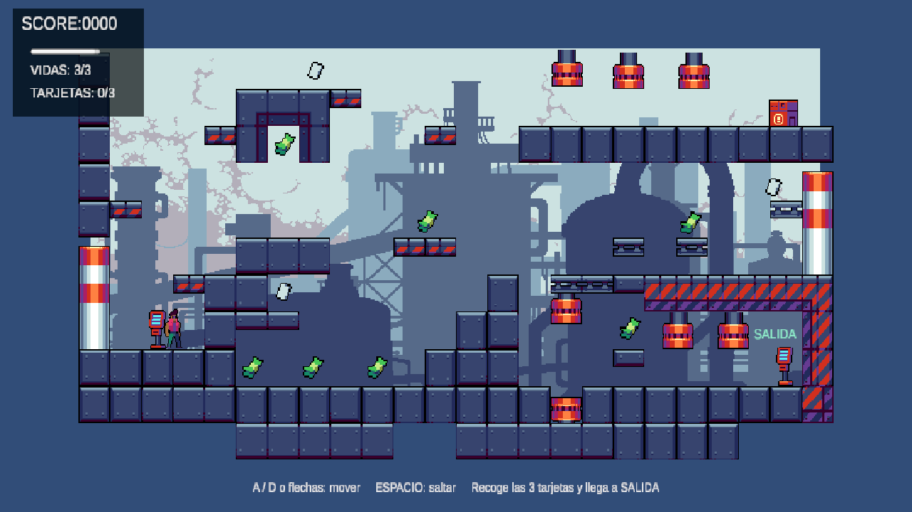
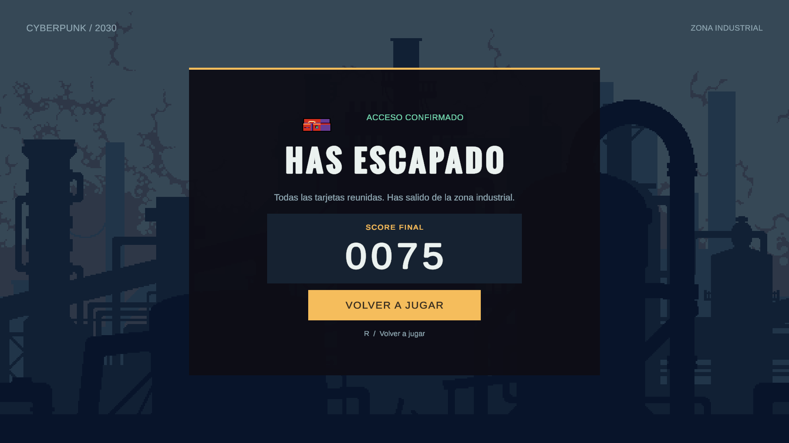

# Clase 2 — Juego de plataformas

Abre `Assets/Scenes/SampleScene.unity` en Unity **6000.4.12f1** y pulsa Play. El paquete `com.unity.pipeline` permite editar y comprobar el proyecto con Unity CLI; la lógica del nivel está en `Personaje.cs`, `Partida.cs`, `Camara.cs` y `AudioManager.cs`. `Victoria.cs` controla la pantalla final.

## Alcance de la planificación

La planificación de plataformas pide para Clase 2: animaciones del personaje y un script que las controle; movimiento; colisiones con objetos recogibles y con objetos dañinos; interacción con el HUD; y fin de juego. Indica además que los sonidos son obligatorios, pero se hacen fuera de clase. Como trabajo previo de Clase 1 figuran el tilemap y fondo, las animaciones automáticas de objetos y el HUD de puntuación y vidas. Fuente local: `../FCV/Teor_a/PlanificacionPlataformas.pdf`, p. 1.

## Controles y reglas actuales

- **A/D o flechas izquierda/derecha:** moverse. **Espacio:** saltar. El proyecto usa la opción de entrada `Both`; estos controles leen Legacy Input mediante `Input.GetAxisRaw`.
- **R:** reiniciar la escena después de terminar, tanto por derrota como por victoria.
- `Personaje.cs` usa tres rayos hacia el suelo y tres hacia el techo, filtrados por la capa `Suelo`. Lee la entrada en `Update()` y calcula las dos componentes de velocidad en `FixedUpdate()`. La gravedad actual ajustada por el usuario es `23.62` unidades/s² en código y `Rigidbody2D.gravityScale` vale cero; el cuerpo sigue siendo Dynamic.
- El personaje es Biker y empieza con **3 vidas**. Al llegar a cero aparece «FIN DEL JUEGO». Caer bajo el escenario no quita vidas ni provoca reaparición.
- La cámara sigue al personaje solo en el eje X desde `LateUpdate()`. Limita su centro horizontal a los bounds de `FondoImagen.SpriteRenderer`, considerando la mitad del ancho visible (`orthographicSize * aspect`); si la vista es más ancha que el fondo, centra la cámara en este. Mantiene Y=0, Z=-10 y tamaño ortográfico 5.
- Los siete martillos tienen Collider2D animados por el clip `MartilloAnimacion`; solo hacen daño en los tramos `Hammer_2` a `Hammer_6`. Los tramos `Hammer_7`, `Hammer_0` y `Hammer_1` son de seguridad. La animación conserva la velocidad **0,5**. No hay una clase dedicada a martillos ni código generador.
- El daño usa `OnTriggerEnter2D`: cada nuevo contacto con un collider activo resta una vida. No hay tinte rojo, bloqueo de movimiento ni temporizador de invulnerabilidad. Si el personaje permanece bajo un martillo, su collider vuelve a activarse con el siguiente golpe y causa otro impacto.
- Dinero suma **10**, cartas **25** y cofres **50** puntos. Cada objeto recogido se elimina. Tras recoger las **tres tarjetas**, `Partida` actualiza el contador del HUD y activa el trigger de salida. Tocar la salida guarda la puntuación y carga `Assets/Scenes/Victoria.unity`, donde aparece «HAS ESCAPADO». El botón «VOLVER A JUGAR» y R cargan otra partida. El requisito de tres tarjetas es una decisión de diseño, no una condición especificada por el profesor.
- El personaje aparece junto a la pantalla roja, en **(-9, -2.45)**. La salida reutiliza la pantalla `Screen2` del paquete, guardada como `Assets/Prefab/Pantalla.prefab`, colocada al final del nivel en **(10.45, -3.45, 0)**, con tag `Salida`, `BoxCollider2D` como Trigger y cartel «SALIDA» en posición local **(-0.3, 0.85, -0.1)**.
- Las puntuaciones, las tres vidas, la condición de tres tarjetas, los controles y la tecla R son decisiones concretas de esta implementación; la planificación no fija esos valores ni esos controles. La música de fondo y el sonido de derrota usan `AudioManager`. La escena Victoria reproduce directamente el mismo clip de victoria con su AudioSource.

## Estructura preparada

```text
SampleScene
├─ Personaje — Personaje.cs
│  ├─ Rigidbody2D Dynamic sin gravedad automática y CapsuleCollider2D
│  ├─ SpriteRenderer
│  └─ Animator — Personaje.controller
│     ├─ Speed (float)
│     ├─ Grounded (bool)
│     └─ Jump, Hurt, Death (triggers)
├─ Martillos — Collider2D activado por MartilloAnimacion
├─ Salida — tag Salida, BoxCollider2D Trigger, cartel SALIDA
├─ Fondo_Tilemap — tag y capa Suelo; collider compuesto y Rigidbody2D Static
├─ FondoImagen — SpriteRenderer usado para limitar el recorrido horizontal de la cámara
├─ Partida — Partida.cs; cuenta tarjetas y gestiona salida y fin
├─ Main Camera — Camara.cs; objetivo Personaje.Transform y límites FondoImagen.SpriteRenderer
│  └─ Cámara Orthographic, Y=0, Z=-10, tamaño 5; seguimiento horizontal con límite
├─ AudioManager — música del nivel y sonido de derrota
└─ Canvas — puntuación, vidas, tarjetas, barra y panel de fin
```

La escena contiene 18 objetos de recogida y daño: 7 de dinero, 3 tarjetas, 1 cofre y 7 martillos, además de la salida. Se eliminó `/Cofres` en la zona inferior (antes en **(10.466, -3.50)**) y se conserva `/Chest_0` en la parte superior. `/Card_0 (1)` se movió de **(10.46, 1.36)** a **(10.1, 1.36)** y se mantiene recolocada. El HUD incluye el contador de tarjetas. `Camara.cs` sigue horizontalmente al personaje y limita la vista a los bounds del fondo; mantiene Y=0, Z=-10 y tamaño ortográfico 5. No usa Cinemachine, zoom, dependencias externas ni código generador.

## Cambios recientes — 16 de octubre de 2026

La variante de trabajo queda documentada en la rama `clase2-experimental`, que sustituye la variante anterior y conserva su historial. Se mantienen el daño de martillos en `Hammer_2`–`Hammer_6`, la seguridad en `Hammer_7`, `Hammer_0` y `Hammer_1`, la aparición junto a la pantalla roja y la salida que se habilita al recoger tres tarjetas. Se retiró el cofre inferior, se colocó la salida al final del nivel y se recolocó la tarjeta. `Camara.cs` sigue al personaje horizontalmente en `LateUpdate()` y limita la vista al fondo; si el ancho visible supera el fondo, la centra. La cámara mantiene Y=0, Z=-10 y tamaño ortográfico 5.

## Relación con los apuntes

- **Alcance y salida:** `PlanificacionPlataformas.pdf`, p. 1, incluye literalmente «Fin de juego», sin especificar la condición concreta. `Teor_a/FCV_5_Clase.pdf`, p. 10 (número impreso de diapositiva 8), recomienda acabar mediante un objeto final, por ejemplo una puerta, que puede activarse al cumplirse una condición; una llave es solo el ejemplo de la diapositiva. La salida condicionada a recoger tres tarjetas aplica esa pauta, pero la cantidad de tarjetas la eligió el usuario.
- **Entrada y movimiento:** `Apuntes/FCV_2.pdf`, p. 6, describe Legacy Input. `Teor_a/FCV_4_Clase.pdf`, pp. 11–14, propone comprobar suelo y techo, calcular la gravedad en código y reunir X e Y en un `Vector2` dentro de `FixedUpdate()`. Ese es el esquema actual de `Personaje.cs`. `Apuntes/FCV_3.pdf`, pp. 19–22, muestra `Physics2D.Raycast`, `LayerMask` y `Debug.DrawRay`. La adaptación usa tres rayos por dirección para cubrir también los bordes de la cápsula. El script usa `Rigidbody2D.linearVelocity` para asignar la velocidad.
- **Triggers 2D:** `Apuntes/FCV_3.pdf`, p. 13, pone monedas, checkpoints, meta y zona de daño como ejemplos de Collider2D Trigger; p. 14 muestra `OnTriggerEnter2D(Collider2D col)`.
- **HUD:** `Apuntes/FCV_1.pdf`, pp. 45–47, presenta texto o iconos, Slider y actualización de salud en el HUD.
- **Cámara:** `Apuntes/FCV_1.pdf`, PDF p. 10 (diapositiva impresa p. 8) y p. 28 (impresa p. 24), indica que `LateUpdate()` es útil para cámaras después de que los objetos se hayan movido. `Apuntes/Apuntes_programacion.pdf`, p. 13 (impresa p. 13), §5.3 y Listing 10, explica `Mathf.Clamp` y muestra limitar la X de un objeto a un rango; no es un script de cámara. `Teor_a/FCV_5_Clase.pdf`, PDF p. 13 (diapositiva impresa p. 10), recomienda parentar la cámara al jugador o usar seguimiento por script/Cinemachine. `Camara.cs` combina estas técnicas como una adaptación para seguir solo en X y limitar el recorrido al fondo; no reproduce un código literal de los apuntes.
- **Animación y fin de juego:** `Apuntes/Apuntes_programacion.pdf`, pp. 20 y 23–24, incluye `SceneManager`, el estado `GameOver` y el control de parámetros del Animator.
- **Sonido:** `Apuntes/Apuntes_programacion.pdf`, pp. 21–22, describe `AudioSource`, `AudioClip` y `PlayOneShot`; p. 29 explica el patrón de instancia única usado por `AudioManager`.

## Verificaciones anteriores del nivel

Compilación comprobada sin errores de C#. Se comprobaron en Play los ocho fotogramas de los siete martillos (56 comprobaciones): los fotogramas 7/0/1 desactivan el collider de daño y los fotogramas 2–6 lo activan. El contacto con un martillo abierto no resta vidas, incluso después de acabar la inmunidad; al cerrarse vuelve a hacer daño.

Se comprobó la aparición junto a la pantalla roja; la salida bloqueada con cero, una o dos tarjetas; su apertura al recoger la tercera; el HUD 3/3 y 75 puntos por las tres tarjetas; la victoria al tocar la pantalla; el personaje detenido en Idle y el reinicio con tres vidas, cero tarjetas y la salida bloqueada. Las comprobaciones previas de recogida, derrota, fricción de paredes y caída sin daño se mantienen. Unity quedó fuera de Play.

Con la cámara de seguimiento se repitieron en Play las comprobaciones de recogida de las tres tarjetas, bloqueo y apertura de la salida, victoria y reinicio. Se comprobó el encuadre al aparecer y al llegar al extremo derecho: tamaño ortográfico 5, altura y profundidad conservadas, fondo cubriendo el ancho de la vista y pantalla de salida con su cartel completos. Solo permanece el cofre superior. Estas pruebas de interacción desplazan al personaje hasta los objetos; no sustituyen una partida manual completa para valorar la dificultad del recorrido.



## Primera simplificación del controlador — 19 de octubre de 2026 (anterior)

`Personaje.cs` pasa de 300 a 211 líneas y no contiene comentarios. Sustituye los eventos de contacto del suelo por rayos y calcula la gravedad en código siguiendo el esquema de la clase 4. Conserva las duraciones de daño, las recogidas y las reglas de finalización. En la escena, `Fondo_Tilemap` usa la capa 8 `Suelo`, la máscara del personaje solo incluye esa capa y la gravedad automática vale cero.

Compilación sin errores. Se ejecutaron 22 comprobaciones temporales en Play: configuración, reposo, salto sin doble salto, gravedad y aterrizaje, filtrado de triggers, techo, bloqueo del salto bajo techo, caída junto a paredes, recogida sin puntuación duplicada, daño e invulnerabilidad, derrota y salida condicionada a las tres tarjetas. Las comprobaciones de movimiento simulan pasos de física; las de recogida y final invocan los callbacks del personaje. No sustituyen una partida manual completa. No se añadieron scripts de prueba al proyecto.

## Victoria y revisión del temario — 19 de octubre de 2026

La pantalla de victoria es una escena guardada con elementos normales de Canvas: fondo, panel, imagen, textos, botón y AudioSource. El diseño se edita desde la jerarquía y el Inspector. `Victoria.cs` ocupa 29 líneas, muestra la cifra y permite volver al nivel; no genera la interfaz.

Se comprobó el paso desde el nivel con tres tarjetas y 75 puntos: Victoria muestra `0075`. El botón, confirmado con Enter, carga SampleScene; R también permite volver. La nueva partida empieza con tres vidas, cero puntos y cero tarjetas. Las posiciones usadas para comprobar las recogidas fueron temporales durante Play. Ambas escenas están activadas en Build Settings.

La correspondencia por temas, las adaptaciones y la ayuda de IA están en [la revisión de apuntes](Documentacion/Revision_apuntes.md).



## Revisión final de Personaje y Partida — 19 de octubre de 2026

`Personaje.cs` se reduce de 211 a 138 líneas y `Partida.cs` de 176 a 100, sin comentarios. El alcance se contrasta con `PlanificacionPlataformas.pdf`, p. 1, `FCV_4_Clase.pdf`, pp. 11–14, y `FCV_5_Clase.pdf`, pp. 8–10. Se eliminan los tres temporizadores de golpe, el tinte rojo, el bloqueo de entrada, el booleano de muerte duplicado, `OnTriggerStay2D`, la preparación de reposo al ganar y métodos que solo envolvían una llamada. Las referencias obligatorias se usan directamente tras comprobar sus asignaciones en el Inspector. La configuración física permanece en el Inspector. Los rayos, la gravedad en código, las animaciones, recogidas, daño, HUD, sonidos, derrota, reinicio y victoria se conservan.

La versión final compila sin errores. En Play se comprobó la derrota mediante golpes reales del martillo y el reinicio con R; salida sin tarjetas bloqueada; 50 puntos por el cofre, 10 por dinero y 25 por cada tarjeta; tres tarjetas abren la salida y Victoria muestra `0135`; volver reinicia vidas a tres, puntos y tarjetas a cero. No aparecieron errores de ejecución. Las pruebas de colisión usaron posiciones temporales durante Play y no sustituyen un recorrido manual completo. La programación de esta simplificación se hizo con Luna Max.
